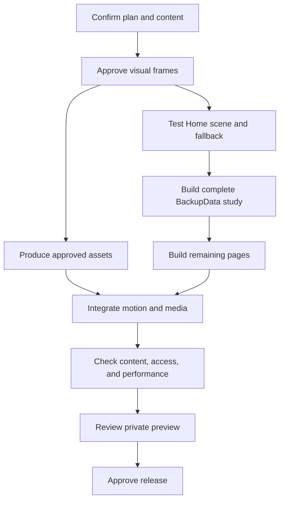

# Build plan and review

## Approval boundary

Arpit requested a complete plan before development.
Arpit authorized Phase 1 implementation on 24 October 2026.
The Phase 1 code passes checks. Arpit's final fact review remains open.
Arpit then authorized Phase 2. The frames now await visual review.
Arpit then authorized Phase 3 with the request for the next phase.
The prototype passes local checks. Physical device checks remain open.
Arpit then authorized Phase 4. The site now has shared navigation and direct routes.
Arpit then authorized Phase 5. The study implementation passes local checks; complete evidence remains pending.
Arpit then authorized Phase 6. Home now uses a dedicated page component and GSAP section motion.
Arpit then authorized Phase 7 and permission to publish the Lighthouse and 1MB details.
Live deployment still needs separate approval.

## Work sequence

The plan tests the highest visual risk before full asset production.
It then builds one complete study as the pattern for the remaining work.

## Tasks

Phase 1 now uses `src/content/` and `tests/`.
Phase 2 uses `design/phase-2/` and the design preview scripts.
Other file names below describe future implementation.

| ID | Task | Dependencies | Likely files | Acceptance | Verification |
| --- | --- | --- | --- | --- | --- |
| P1 | Confirm career and project evidence | None | Career data; source register; decision list | Dates have precision labels. AI work has context and status. | Arpit reviews the facts. |
| P2 | Approve visual frames | P1 | Home frame; study frame; AI frame; mobile frame | Type, palette, object, and layout form one system. | Compare desktop and mobile frames. |
| P3 | Test the scene and film | P2 | HeroScene; SceneModel; PosterFallback; ScrollFilm; motion settings | Layer controls work. Video follows scroll. Both fallbacks work. | Profile two devices; test scroll reversal and keyboard controls. |
| P4 | Build navigation | P2 | Root layout; SiteHeader; MobileMenu; SiteFooter; tokens | All links work. Keyboard users can open and close the menu. | Check keyboard focus and direct routes. |
| P5 | Build BackupData study | P1, P4 | Study layout; BackupData content; MediaStage; DecisionRecord; SystemDiagram | One complete study contains real evidence and clear responsibility. | Review copy, images, links, and mobile layout. |
| P6 | Build Home | P3, P5 | Home route; StorySequence; ProjectFeature; CareerSummary; ContactLinks | Home explains scope and links to current AI work. | Run the ten-second clarity review. |
| P7 | Build Lighthouse and 1MB studies | P5 | Two content files; integration diagram; extension walkthrough | Each study distinguishes contribution from product context. | Review claims against sources. |
| P8 | Build Turby study | P5 | Turby content; TraitGallery; trait data | Original assets support the visual story. | Check gallery with touch and keyboard. |
| P9 | Build AI Systems | P1, P5 | AI route; AI data; ExamplePanel; Transcript; EvaluationPanel | Lighthouse work and later projects remain distinct. | Check labels, examples, and dates. |
| P10 | Build Work archive | P7, P8 | Work route; ProjectIndex; ArchiveEntry; SMDEVOPS data | All six earlier projects appear under SMDEVOPS. | Open each entry with keyboard and touch. |
| P11 | Build Journey and About | P1, P4 | Two routes; CareerTimeline; EventGallery; education data | All known career stages appear. Certifications remain absent. | Check against the content register. |
| P12 | Build Contact | P1, P4 | Contact route; CopyEmail; resume file; contact data | Email and resume work without a form backend. | Test mail link, copy failure, and PDF access. |
| P13 | Produce final media | P2, P3 | Asset manifest; image masters; video masters; optimized exports | Approved files meet the asset brief. | Inspect every image and video. |
| P14 | Integrate motion and media | P6–P13 | MotionProvider; motion helpers; media manifest; scene settings | Motion settings apply across pages. Rich media pauses off-screen. | Check reduced motion and hidden-tab behavior. |
| P15 | Add metadata and old-link support | P6–P12 | Metadata helper; sitemap; robots; legacy routes; missing page | Direct links and known old fragments resolve correctly. | Open each old and new URL. |
| P16 | Review private preview | P14, P15 | Review report; issue list; release checklist | No critical content, navigation, or access errors remain. | Run the release matrix below. |
| P17 | Release after approval | P16 | Deployment settings; domain settings; rollback record | Public routes work on the approved domain. | Check production and retain rollback details. |

Each task should remain a small implementation unit.
Split a task if it needs more than five primary source files.
The asset task contains separate jobs for images, video, and recordings.

## Review checkpoints

### After P2

Arpit reviews four concrete design frames:

- Desktop Home opening and first project section.
- Desktop BackupData study.
- AI Systems with one real example.
- Mobile Home and study layout.

The review confirms visual direction before full production.
The four-layer object remains replaceable at this point.

### After P5

Review the complete BackupData path.
Check the summary, technical detail, motion, media, and contact route.
Use this study to confirm the depth for the remaining pages.

### After P14

Review all content with motion off.
Then review motion and media with the enhanced mode.
Both modes must expose the same professional facts.

### Before P17

Arpit reviews the private preview and release checklist.
The release plan names the hosting target and rollback method.
The live site changes only after that approval.

## Estimated effort

These ranges assume one experienced builder and timely access to source assets.
They are planning estimates, not delivery commitments.

| Work area | Focused work days |
| --- | --- |
| Content confirmation and case-study interviews | 2–3 |
| Visual frames and object direction | 2–3 |
| Scene prototype and fallback | 2–3 |
| Core routes and project studies | 5–8 |
| AI examples and evidence | 2–4 |
| Asset production and edit | 2–4 |
| Motion, access, performance, and release checks | 3–5 |
| Total | 18–30 |

Asset availability and review time can extend calendar duration.
A complete 3D world or live AI demo would require a separate estimate.

## Release test matrix

| Area | Required check | Pass condition |
| --- | --- | --- |
| Content | Compare claims with sources | No unsupported role, metric, date, or outcome |
| Dates | Inspect the AI period | Future work carries a planned label |
| Attribution | Inspect company project studies | Each study names the employment or client context |
| Desktop | Test Chrome and Safari | All routes, controls, and media work |
| Mobile | Test iPhone Safari and Android Chrome | No clipped text, trapped scroll, or hidden controls |
| Tablet | Test an intermediate width | Layout changes preserve the content order |
| Keyboard | Tab, Shift+Tab, Enter, Space, Escape | Focus remains visible and predictable |
| Screen reader | Read navigation, studies, and controls | Facts and actions have meaningful names |
| Zoom | Test 200% text and narrow reflow | Content remains readable without page-wide horizontal scroll |
| Motion | Enable system reduced motion and site motion control | No pin, parallax, camera travel, or automatic decorative video |
| Visual density | Inspect Home at desktop and mobile widths | One main visual per feature; clear space between features |
| 3D controls | Select layers and assemble through pointer, keyboard, and touch | Controls give equivalent results without a transform conflict |
| Scroll video | Scroll forward, reverse, stop, and jump into the section | Film follows the current position without an outdated seek queue |
| Media ownership | Enter the film section from the 3D section | Only one rich visual remains active |
| Failure | Block JavaScript and WebGL separately | Main content and contact routes remain useful |
| Media | Reject autoplay and fail a media request | Poster and clear controls remain available |
| Navigation | Enter studies directly; use back and forward | Correct page and useful scroll behavior |
| Legacy URLs | Open all known hash routes | Correct new destination |
| Performance | Test representative pages on a fixed lab profile | Record LCP, CLS, transfer, and interaction traces |
| Scene | Measure frame time and resource counts | Scene stays within its selected quality tier |
| Cleanup | Enter and leave scene routes repeatedly | No growing set of active listeners or owned GPU resources |
| Links | Check email, resume, project, and social links | No broken primary action |
| Search | Inspect rendered HTML and metadata | Each page exposes meaningful text and a correct canonical URL |

Use targeted automated tests for route migration, content validation, and important controls.
Use manual checks for visual quality, screen-reader output, and motion comfort.
Do not add tests that merely repeat static text from the implementation.

## Proposed usability checks

Ask three people who did not write the site to complete these tasks.
Include at least one person who assesses engineering candidates.

1. Explain Arpit's professional scope after ten seconds on Home.
2. Find his strongest example of complete product ownership.
3. Identify his contribution to one project.
4. Find his current AI work.
5. Find a technical decision and its consequence.
6. Find his email and resume.

Record confusion and failed tasks.
Change the content or layout before adding more animation.
This review remains future work.

## Risks and responses

| Risk | Effect | Response |
| --- | --- | --- |
| Weak project evidence | Studies feel generic | Collect real decisions and artifacts before final copy |
| Too much initial media | Slow first load | Show text and poster first; defer 3D and video |
| Generated geometry changes | Video conflicts with the runtime object | Render exact geometry locally if necessary |
| Broad AI claims without examples | Employers cannot assess depth | Present a small number of concrete workflows |
| Future dates look complete | Career record loses accuracy | Separate active, complete, and planned work |
| Heavy scroll effects on mobile | Navigation becomes difficult | Use normal flow and static story frames |
| Draft letters appear final | Public claims exceed document status | Confirm final text and attribution |
| Private product data enters media | Public assets expose unnecessary details | Use redacted or test records |
| Current product features exceed historical work | Attribution becomes inaccurate | Confirm the scope of each contribution |

## Scope exclusions

- Certification gallery.
- Mandatory 3D navigation.
- Account system or database for the portfolio.
- Live wallet connection.
- Live AI assistant in the first release.
- Empty blog or articles with no original content.
- Fake client logos, fabricated metrics, and invented testimonials.
- Automatic sound.
- Background video in every section.

## Review record

| Decision | Current state |
| --- | --- |
| Audience | Confirmed: employers for senior engineering and technical leadership |
| Visual direction | Confirmed: dark, precise, light sections, controlled 3D |
| Layout density | Confirmed: more space and fewer visible elements than the preview |
| Motion requirements | Confirmed: scroll animation, direct 3D interaction, and video scroll control |
| SMDEVOPS projects | Confirmed: all six earlier projects belong to that role |
| SMDEVOPS end | Approximate: three months before Lighthouse |
| Lighthouse AI work | Confirmed: agent memory and context sharing; BackupData extension |
| Later AI context | Confirmed: freelance and personal projects |
| Later AI period | Supplied: August–November 2026; November remains future at review date |
| Ten-page structure | Proposed |
| Layered object concept | Proposed |
| Palette and typography | Proposed |
| AI tools and measurements | Pending |
| Public assets and final resume | Pending |
| Development | Phase 1 authorized; content code and checks complete; final fact review open |
| Phase 2 | Frames and browser checks complete; final visual approval open |
| Phase 3 | Interactive prototype and local checks complete; physical device review open |
| Phase 4 | Shared navigation and ten direct routes; full page content follows in later phases |
| Phase 5 | Study implementation passes local checks; decisions, media, dates, and results remain open |
| Phase 6 | Dedicated Home page, project links, career summary, and scroll motion |
| Phase 7 | Dedicated Lighthouse and 1MB studies; technical evidence and original media remain open |
| Phase 8 | Turby study and original-image gallery; layered traits and technical details remain open |
| Phase 9 | AI Systems implementation and local examples; historical project evidence remains open |
| Phase 10 | Work archive with four studies and six SMDEVOPS entries; individual project evidence remains open |
| Phase 11 | Journey and About with confirmed records; final letters, event media, resume, and recommendation remain open |
| Phase 12 | Contact page and copy controls pass local checks; resume file and PDF checks remain open |
| Phase 13 | Media package and comparison checks complete; generated geometry rejected; real source media remains open |
| Phase 14 | Approved media and shared motion controls pass local checks; physical device review remains open |
| Phase 15 | Metadata, share images, sitemap, preview robots, and old-hash migration pass checks |
| Phase 16 | Local regression, accessibility, failure, zoom, and load checks pass; release requirements remain open |

## Change procedure

Update this decision record when Arpit changes the scope.
Update affected page, motion, and asset specifications together.
Keep one approved plan as the reference for development.
